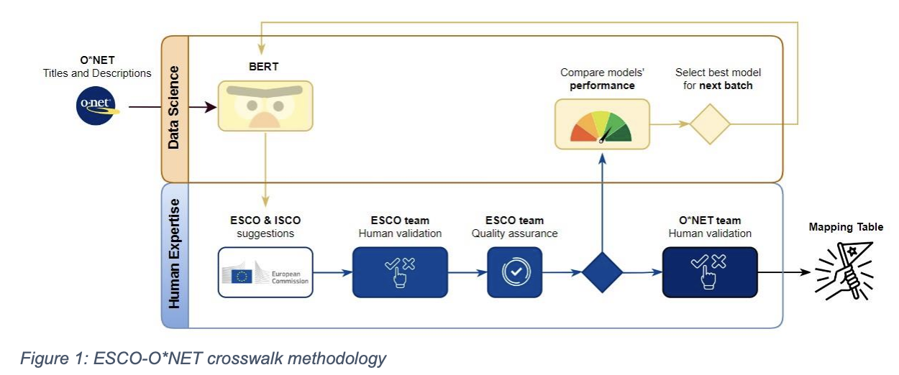

# VEWD-2026 O*NET–NCS Crosswalk

* O\*NET과 NCS를 의미 유사도로 연결하는 작업입니다.
* DISCLAIMER: THIS IS PERSONAL WORK. NOT AUTHORIZED BY US Employment and Training Administration, National Center for O\*NET Development nor ROK Mnistry of Employment of Labor, Human Resources Development Service of Korea.

- NCS 능력단위요소의 "수행준거"와 O*NET의 "Task Statements"를 BERT 계열 임베딩 모델로 연결하고, 사람이 검증합니다.
- crosswalk between ESCO and O\*NET에서 사용한 방식을 차용했으며, 자세한 사항은 아래 링크를 확인해 주세요.
  ([esco.ec.europa.eu/en/use-esco/other-crosswalks](https://esco.ec.europa.eu/en/use-esco/other-crosswalks))
  
  (출처: [esco.ec.europa.eu/system/files/2022-12/ONET%20ESCO%20Technical%20Report.pdf](<https://esco.ec.europa.eu/system/files/2022-12/ONET%20ESCO%20Technical%20Report.pdf>))

## 절차

ESCO–O\*NET 보고서와 같이 모델의 제안과 사람의 검증을 번갈아 진행합니다. 한국어 수행준거와 영어 Task를 번역 없이 다국어 임베딩 모델로 비교합니다.

1. **자료 정제**: NCS 원자료에서 수행준거 196,657개를 뽑습니다. O\*NET 30.2의 Task는 18,796개입니다.
2. **후보 찾기**: 수행준거와 Task를 임베딩해 수행준거마다 가까운 Task를 찾습니다.
3. **검증표 만들기**: NCS 대분류 24개에서 고르게 수행준거를 뽑고, 비교할 모델들의 상위 5개 Task를 합쳐 무작위 순서로 보여 줍니다.
4. **사람 검증**: 검증자가 후보마다 관계 유형(일치·좁음·넓음·근접·관련·오류)을 판정합니다. 일부는 두 번째 검증자가 따로 판정합니다.
5. **모델 비교**: 판정 결과로 상위 k 적중률을 계산해 가장 잘 맞는 모델을 고르고, 다음 묶음에서 새 모델과 다시 비교합니다.
6. **연계표 만들기**: 정해진 모델을 수행준거 전체에 적용합니다.

단계별 방법과 수치는 [METHOD.md](METHOD.md)에 있습니다.

## 설치 (macOS, Apple Silicon 기준)

시스템 Python 버전과 무관하게, 이 폴더 전용 Python 3.12 가상환경(`.venv`)을 만듭니다. PyTorch가 최신 버전의 Python에서 에러를 일으키는 경우가 있기 때문입니다.

```bash
brew install uv
```

```bash
uv venv
```

```bash
uv pip install -r requirements.txt
```

`uv venv`는 `.python-version` 파일을 읽어 Python 3.12를 자동으로 내려받습니다.

## 따로 받아야 하는 자료

아래 파일은 GitHub의 파일 크기 제한(100MB)을 넘어 저장소에 없습니다. 따로 공유받아 같은 경로에 넣어 주세요.

| 파일                              | 링크                                                                                                                                                      | 쓰임                                            |
| --------------------------------- | --------------------------------------------------------------------------------------------------------------------------------------------------------- | ----------------------------------------------- |
| `data-NCS/NCS-DB(2026-02).xlsx` | [ncs.go.kr/th06/bbs_lib_view.do?libDstinCd=01&amp;libSeq=20260205111407114](https://ncs.go.kr/th06/bbs_lib_view.do?libDstinCd=01&libSeq=20260205111407114) | NCS 원자료. `clean_ncs.py` 실행에 필요합니다. |

NCS 원자료를 넣은 뒤 아래 명령으로 정제본 두 개를 만듭니다. 자세한 내용은 [METHOD.md](METHOD.md) 2절에 있습니다.

```bash
.venv/bin/python clean_ncs.py
```

## 실행 순서

모든 명령은 `.venv/bin/python` 뒤에 붙여 실행합니다. 오래 걸리는 단계는 중간 결과를 저장하므로 멈춰도 다시 실행하면 이어서 합니다.

| 순서 | 명령                                                                                                  | 하는 일                                                            |
| ---- | ----------------------------------------------------------------------------------------------------- | ------------------------------------------------------------------ |
| 1    | `clean_ncs.py`                                                                                      | NCS 원자료 정제                                                    |
| 2    | `embed_texts.py`                                                                                    | 수행준거와 Task 임베딩 (multilingual-e5-large, 약 2시간 40분)      |
| 3    | `find_candidates.py`                                                                                | 수행준거마다 Task 상위 10개 찾기                                   |
| 4    | `make_validation.py`, `make_validation2.py`, `make_validation3.py`                              | 수행준거 → Task 검증표 1~3번                                      |
| 5    | `make_occ_validation.py`, `make_occ_validation2.py`, `make_occ_recheck.py`                                               | 세분류 → 직업 검증표                                              |
| 6    | `evaluate_recalc.py`, `evaluate_validation2.py`, `evaluate_validation3.py`, `evaluate_occ.py`, `evaluate_occ_recheck.py` | 판정된 검증표로 모델 비교                                          |
| 7    | `caffeinate -i .venv/bin/python build_crosswalk.py`                                                 | 최종 모델을 전체에 적용 (며칠 걸림). `--status`로 진행 상황 확인 |

검증표를 만드는 스크립트는 같은 이름의 검증표가 있으면 멈춥니다. 판정한 내용을 덮어쓰지 않기 위해서입니다. 결과는 `data-ONET-NCS/` 아래에 저장됩니다.

## 동작 확인

```bash
.venv/bin/python check_model.py
```

처음 실행할 때 모델(약 2.2GB)을 `~/.cache/huggingface`에 내려받습니다.
마지막 줄에 `성공`이 나오고 `device: mps`로 표시되면 준비가 끝난 것입니다.

(추천하지 않음) 메모리가 부족하면 반정밀 모드를 씁니다.

```bash
.venv/bin/python check_model.py --fp16
```

## VS Code에서 작업하기

1. VS Code에서 이 폴더를 엽니다 (`파일 > 폴더 열기`).
2. 오른쪽 아래에 뜨는 권장 확장(Python, Jupyter) 설치 알림을 수락합니다.
3. 인터프리터는 `.venv`가 자동으로 선택됩니다. 선택되지 않으면 `Cmd+Shift+P` →
   `Python: Select Interpreter` → `.venv`를 고릅니다.
4. `.py` 파일은 오른쪽 위 실행 버튼으로, 노트북(`.ipynb`)은 커널을 `.venv`로 골라 실행합니다.

## 코드에서 사용하기(예시)

```python
from e5_embedder import load_model, embed

model = load_model()                      # 메모리가 부족하면 load_model(fp16=True)
onet = embed(model, ["Registered Nurses: Assess patient health problems..."])
ncs = embed(model, ["간호: 환자의 건강 문제를 사정하고...", "용접: 금속 재료를 접합..."])

print(onet @ ncs.T)                       # 코사인 유사도 (행: O*NET, 열: NCS)
```

## 알아 둘 점

- **접두어**: e5는 입력 앞에 `query: `가 필요하며 `embed()`가 자동으로 붙입니다. e5-instruct는 수행준거 쪽에만 지시문을 붙입니다.
- **주의**: e5의 유사도는 대부분 0.7~0.9 사이에 몰립니다. 절대값이 아니라 순위로 판단해야 합니다.
  직무 설명문을 함께 넣어야 구분이 가능합니다. 직업명으로만 비교할 경우 점수 차이가 작습니다.
- **입력 길이**: 512 토큰을 넘는 부분은 잘립니다.
- **메모리**: batch_size=""의 ""에 컴퓨팅 환경의 메모리 용량을 입력합니다. 8GB 메모리를 사용한다면`batch_size=8`으로 작성하고, 다른 앱을 닫고 실행하는 것이 좋습니다.
- **모델 내려받기**: 처음 실행할 때 e5(약 2.2GB) 외에 e5-instruct와 재순위 모델도 `~/.cache/huggingface`에 내려받습니다.
